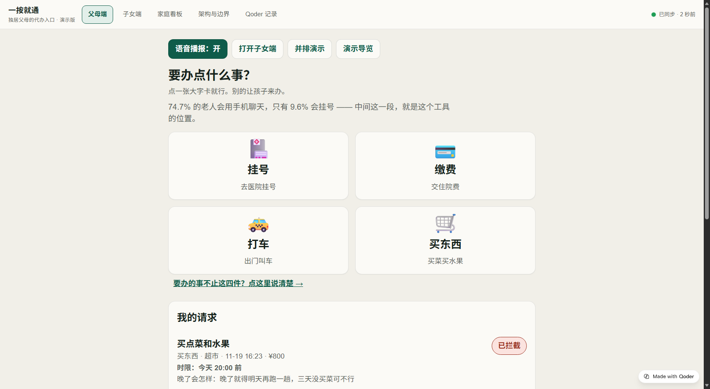
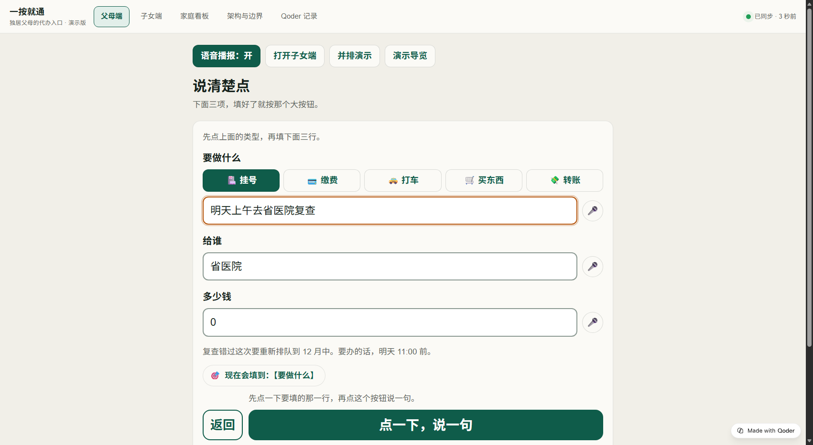
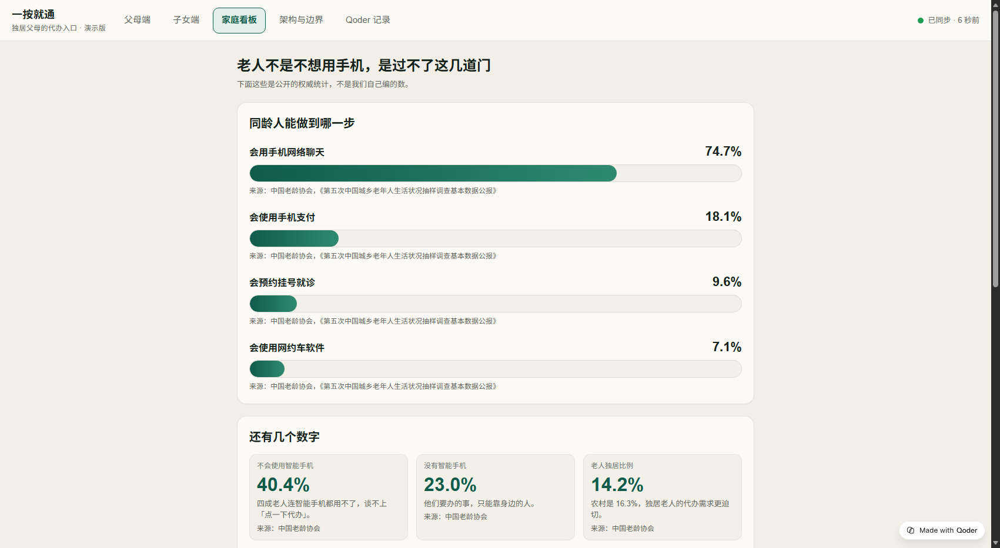
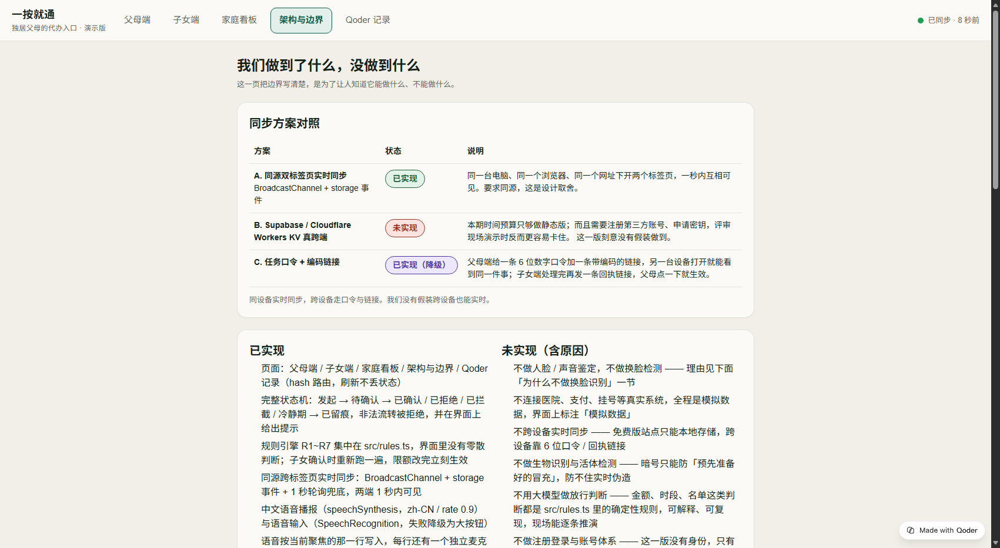
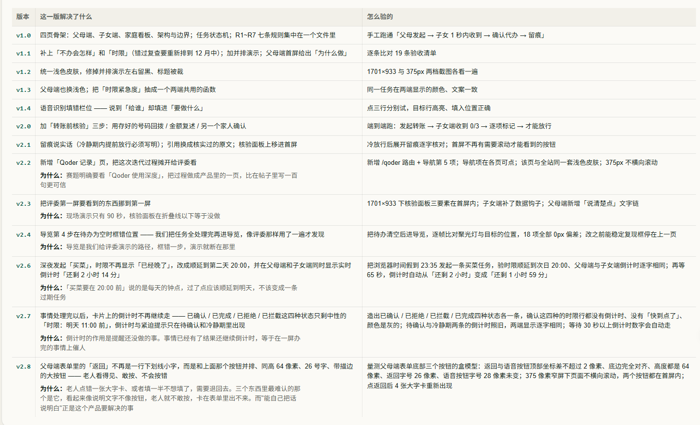

# 一按就通 · 独居父母的一键代办入口

> 爸妈点一下大字卡，1 秒后孩子手机上就收到「要办什么事、多少钱、给谁」。
> 孩子确认之前，系统按家里自己定的规矩先拦一道；每一笔转账、每一次确认都留痕。

| | |
|---|---|
| 🌍 **在线体验（含 90 秒导览）** | https://yiyatong-myys8m4xiju.qoder.zone/?guide=1#/parent |
| 🧒 **子女端直链** | https://yiyatong-myys8m4xiju.qoder.zone/?role=child |
| 🏆 **赛事** | 2026 Qoder 高校创造力大赛 · Hack4Good 赛道 |
| 🧑‍💻 **使用的 Qoder 账号** | `Breeze` |
| 🛠 **部署** | Qoder Sites（静态站点，无后端、无数据库、无 API Key） |

---

## 一、这是什么问题

中国老龄协会《第五次中国城乡老年人生活状况抽样调查基本数据公报》：

```
会用手机网络聊天 74.7%  →  会用手机支付 18.1%  →  会预约挂号就诊 9.6%  →  会用网约车 7.1%
不会使用智能手机 40.4%          没有智能手机 23.0%          老人独居比例 14.2%（农村 16.3%）
```

老人不是不愿意用手机，是被卡在 **「支付 — 挂号 — 打车」** 这三道闸门前面。

《人民法院报》2026-04-01《警惕涉老诈骗》：养老诈骗立案 41090 起、破案 39294 起、打掉团伙 4735 个、抓获 6.6 万余人、追赃 308 亿余元。

同一篇里还有一句话，直接决定了产品取向：

> 在日常沟通中，坚决摒弃"你又被骗了！""这都是假的，别买了！"等否定性和指责性表述，这类话语会激起老人的羞耻感和逆反心理，关闭沟通的大门。

所以这个工具里没有一句"你被骗了"。它只做两件事：**把决定权交回子女、把过程留痕。**

---

## 二、它长什么样

**父母端** —— 字大、按钮大、能说话



**父母端表单** —— 每行左边一个独立麦克风按钮，想说哪行点哪行，不会填错行



**子女端** —— 金额 / 对象 / 时间三个信息做成最大字号，不点开就知道要不要批；转账还要先过三步核验


**父母端表单底部** —— 「返回」与「点一下，说一句」并排同高 64 像素


**家庭看板** —— 74.7% → 18.1% → 9.6% → 7.1% 的漏斗，每一格都有来源链接



**家庭留痕** —— 谁做的、什么时候、为什么、命中了哪条规则


**架构与边界** —— 做到了什么、没做到什么，写在明面上



---

## 三、规则在哪

子女端先设规矩，**规矩都是家人自己定的**，不是系统替他们决定的：

| 规矩 | 命中后 |
|---|---|
| 单笔限额 | 直接拦截 |
| 每日累计限额 | 直接拦截 |
| 夜间时段（22:00–06:00） | 进入 30 分钟冷静期 |
| 金额接近限额（≥60%） | 进入 30 分钟冷静期 |
| 第一次转给不在「可信名单」里的人 | 进入 30 分钟冷静期 |
| 约定的暗号核对不通过 | 直接拦截 |

**转账多一道核验**：任何转账在放行前必须先完成 3 步人工核验 ——

1. 用存好的号码回拨（不要按来电显示回拨）
2. 向对方复述金额
3. 由另一个家人确认

三步做不齐，按钮点不动。冷静期里可以撤回，也可以提前放行 —— 但放行会**如实写进留痕**，写明是"冷静期内提前放行"。

### 我们不做的事

- **不做 AI 换脸识别。** 换脸鉴定需要真实人脸与活体检测，不是网页原型能做的事，也不是学生团队该吹的牛。我们把"识别"换成"拦截"：用流程对抗伪造，而不是用模型赌一次。
- **不用大模型做核心判断。** 限额、时段、暗号、可信名单这四条一旦判错，代价是真金白银 —— 模型的不确定性在这里是负资产。所以它们全部是确定性规则引擎，每一次命中都能说出是哪条规则。
- **不接真实的支付 / 挂号 / 医院接口。** 这一版刻意停在模拟数据上，界面上每一个数字都标了"模拟"。我们宁可把边界说清楚，也不想让人以为它能真的扣钱。

---

## 四、我们是怎么用 Qoder 做出来的

这一节是本仓库最想让人看的部分。**每一版代码和每一次部署都由 Qoder 完成**；我们负责需求、验收标准、边界。

### 1. 先写规格，再让 Qoder 生成

我们先做了一份 Spec，写清：用户是谁、5 步流程、状态机的 6 条合法流转、7 条规则、老人端 UI 规范、以及明确不做什么。这份 Spec 决定了后面少走多少弯路 —— 也决定了我们能守住"不做 AI 换脸鉴定"这条线。

### 2. 用 Rules 把"适老"变成硬约束，而不是靠自觉

我们建了一条 `elder-ui` 规则，把父母端的最小字号、主按钮高度、对比度、一屏一动作、语音必须播报、禁止术语写成硬约束。规则生效之后，我们要求整个父母端按它重做 —— **不是我们审美更好，是我们把要求写成了 AI 不能违反的规则。**

### 3. 用 Sites 的预览 + 标注做迭代，而不是每次重写

整个应用在 Qoder Sites 里通过对话生成，右侧预览面板直接点按钮实测；改需求时用画布 Annotate 指着某个元素说"这里改成大按钮"，比写文字描述快得多。

### 4. 我们用 Qoder 撞到过一个真实的坑，并把它写进了架构页

Qoder 官方文档明确提醒：发布站点不会自动把浏览器本地数据同步给其他用户 —— 这意味着"本地存储假装跨端"是个假象。我们的解法是三段式降级：

```
同源多标签页  →  BroadcastChannel 实时同步
                    ↓ 不行
              storage 事件兜底
                    ↓ 不行
              跨设备降级：6 位口令 + 编码链接
```

### 5. 最后几轮（v2.2 起），改用 Qoder 官方 CLI 驱动 Qoder 自己的 Agent

不想让"用 Qoder 做"变成一句口号。改法是：用 Qoder 官方命令行界面，把一份《改动说明》交给 Qoder 的 Agent —— 说明里写清

- 要改哪几个文件
- 每一条验收标准
- **哪些文件一个字都不许动**（规则引擎、状态机、依赖清单都不许碰）

Agent 自己读代码、量像素、改代码、跑构建、再用无头浏览器按验收标准自测一遍。命令行里留有完整会话记录，我们把它导成了可回看的 HTML。

> **这 8 份原始会话记录已经挂在产品内**：打开导航栏第 5 项「Qoder 记录」，往下滚到「每一轮的原始会话记录」，每一版对应一个链接，新标签页打开，能看到 Agent 那一次到底读了哪些文件、改了什么、怎么自测的。
> （约 568 次工具调用，含 Bash / Read / Write / Edit / Grep。）
>
> 这些 HTML 有意**没有**放进本仓库：它们含非 UTF-8 字节，而 Tailwind v4 的源码扫描器会扫到 `public/`，会让 `npm run build` 直接失败。详见 `.gitignore` 里的注释。

### 6. 我们把评审规则抄成了验收清单

赛题页说评分会看"问题是否真实、流程是否走得通、体验与设计、Qoder 使用深度"。我们把这四句抄成了四张验收清单，每一轮迭代都对着它过一遍。

---

## 五、迭代记录

| 版本 | 这一版解决了什么 | 怎么验的 |
|---|---|---|
| v1.0 | 四页骨架：父母端、子女端、家庭看板、架构与边界；任务状态机；R1~R7 七条规则集中在一个文件里 | 手工跑通「父母发起 → 子女 1 秒内收到 → 确认代办 → 留痕」 |
| v1.1 | 补上「不办会怎样」和「时限」（错过复查要重新排到 12 月中）；加并排演示；父母端首屏给出「为什么做」 | 逐条比对 19 条验收清单 |
| v1.2 | 统一浅色皮肤，修掉并排演示左右留黑、标题被裁 | 1701×933 与 375px 两档截图各看一遍 |
| v1.3 | 父母端也换浅色；把「时限紧急度」抽成一个两端共用的函数 | 同一任务在两端显示的颜色、文案一致 |
| v1.4 | 语音识别填错栏位 —— 说到「给谁」却填进「要做什么」 | 点三行分别试，目标行高亮、填入位置正确 |
| v2.0 | 加「转账前核验」三步：用存好的号码回拨 / 金额复述 / 另一个家人确认 | 端到端跑：发起转账 → 子女端收到 0/3 → 逐项标记 → 才能放行 |
| v2.1 | 留痕说实话（冷静期内提前放行必须写明）；引用换成核实过的原文；核验面板上移进首屏 | 冷放行后展开留痕逐字核对；首屏不再有需要滚动才能看到的按钮 |
| v2.2 | 新增「Qoder 记录」页，把这次迭代过程摊开给评委看 | 新增 `/qoder` 路由 + 导航第 5 项；该页与全站同一套浅色皮肤；375px 不横向滚动 |
| v2.3 | 把评委第一屏要看到的东西挪到第一屏 | 1701×933 下核验面板三要素在首屏内；父母端新增「说清楚点」文字链 |
| v2.4 | 导览第 4 步在待办为空时框错位置 —— 我们把任务全处理完再进导览，像评委那样用了一遍才发现 | 把待办清空后进导览，逐帧比对聚光灯与目标的位置，18 项全部 0px 偏差；改之前能稳定复现框停在上一页 |
| v2.6 | 深夜发起「买菜」，时限不再显示「已经晚了」，改成顺延到第二天 20:00，并在两端同时显示实时倒计时「还剩 2 小时 14 分」 | 把浏览器时间假到 23:35 发起一条买菜任务，验时限顺延到次日 20:00、两端倒计时逐字相同；再等 65 秒，倒计时自动从「还剩 2 小时」变成「还剩 1 小时 59 分」 |
| v2.7 | 事情处理完以后，倒计时不再继续走 —— 已确认 / 已完成 / 已拒绝 / 已拦截只剩中性的「时限：明天 11:00 前」 | 造出四种状态各一条，确认这四种的时限行都没有倒计时、没有「快到点了」、颜色是灰的；待确认与冷静期两条的倒计时照旧，两端显示逐字相同 |
| v2.8 | 父母端表单里的「返回」不再是一行下划线小字，而是和上面那个按钮并排、同高 64 像素、26 号字、带描边的大按钮 | 量测三个按钮的盒模型：返回与语音按钮顶部坐标差不超过 2 像素、高度都是 64 像素；375 像素窄屏下不横向滚动；点返回后 4 张大字卡重新出现 |

> 表里没有 **v2.5** —— 因为 v2.5 这一版的全部内容，就是"给迭代表补上 v2.4 那一行"。它改的是这张表本身，所以它不在表里。
> 完整版（含每一版的「为什么改」）在产品的「Qoder 记录」页里可以逐行对照。



---

## 六、本地跑起来

需要 Node `^22.13.0 || >=24.0.0`。

```sh
npm ci
npm run dev          # 开发
npm run build        # 构建（tsc --noEmit + vite），产物在 dist/
npm run preview      # 本地预览构建结果
```

部署到 Qoder Sites：在项目里用 Sites 能力，`webDirectory` 填 `dist`，`projectRoot` 保持本目录不变。

> 克隆之后 `public/transcripts/` 是空的 —— 这是**有意**的：这 8 份 Qoder CLI 会话记录导出含非 UTF-8 字节，会让 Tailwind v4 的源码扫描器直接报 `Invalid code point` 而构建失败。线上版本里它们是齐全的，可以在导航栏第 5 项「Qoder 记录」里逐版打开。

---

## 七、目录结构

```
src/
  pages/          Parent 父母端 · Child 子女端 · Board 家庭看板 · Arch 架构与边界 · Qoder 迭代记录
  components/     TaskCard 任务卡 · RiskBar 冷静期条 · TraceTimeline 留痕 · GuideBar 6 步导览 · VoiceButton …
  rules.ts        R1~R7 七条规则，唯一的判定入口（改动受保护）
  state.ts        状态机与流转，6 条合法流转（改动受保护）
  types.ts        数据模型与时限 / 倒计时文案
  sync.ts         BroadcastChannel + storage 事件 + 口令链接，三通道同步
  voice.ts        Web Speech API 封装（播报 + 识别，无需 API Key）
  styles/         适老皮肤
public/
  transcripts/    8 份 Qoder CLI 原始会话记录导出（见 .gitignore 注释；线上可浏览）
docs/images/      README 用到的截图
```

---

## 八、引用来源

- 中国老龄协会《第五次中国城乡老年人生活状况抽样调查基本数据公报》 <https://www.cncaprc.gov.cn/u/cms/www/202602/09174810q0zc.pdf>
- 《人民法院报》2026-04-01《警惕涉老诈骗》 <http://society.people.com.cn/n1/2026/0401/c1008-40692985.html>
- 最高人民检察院网站刊发的《人民检察》专题文章《AI换脸的应用风险及治理》 <https://www.spp.gov.cn/spp/llyj/202506/t20250620_698776.shtml>
- 《2025 年度国家老龄事业发展公报》（长护险参保 30854.76 万人 vs 享受待遇 192.91 万人） <https://news.gmw.cn/2026-08/02/content_38922170.htm>
- 《中国城乡老年人生活状况抽样调查》异地就医数据（跨省 679.9 万人次） <https://www.cncaprc.gov.cn/u/cms/www/202602/05180922r4vj.pdf>

---

## 九、致谢与许可

本项目基于 Qoder Sites 的 React + TypeScript + Vite + Tailwind 起始模板构建，模板来源与第三方组件的许可说明见 [`PROVENANCE.md`](PROVENANCE.md) 与 [`vendor/`](vendor/)。依赖各自保留其原有许可。
